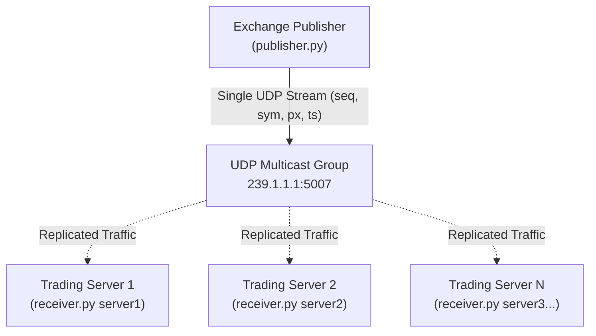

# Multicast Market Data Simulator

A lightweight Python demonstration of how financial stock exchanges publish market data feeds over UDP multicast and how downstream trading subscribers detect packet loss using sequence number gap detection. In modern electronic trading venues (such as NASDAQ, CME, or NSE), exchanges broadcast millions of price updates per second. Sending individual copies to every subscriber via TCP or unicast UDP would overwhelm the exchange's network and introduce latency variance. Instead, exchanges transmit a single UDP multicast stream that network switches replicate to all subscribed participants simultaneously. This project simulates that exchange broadcast and receiver architecture using only the Python standard library.

---

## 1. Key Concepts

### Multicast vs Unicast vs Broadcast
- **Unicast (1-to-1):** The sender opens an independent connection or datagram stream to each receiver. If an exchange has 500 trading firms subscribed, it must duplicate and transmit every market tick 500 times. This consumes high bandwidth and causes unfair latency differences between the first and last recipient.
- **Broadcast (1-to-all):** The sender transmits a packet to every machine on the local subnet (`255.255.255.255`). Every host's network card and CPU must process the packet, even if the machine has no interest in market data. Broadcast traffic is typically blocked by routers and does not scale beyond a single broadcast domain.
- **Multicast (1-to-many):** The sender transmits a single packet addressed to a Class D multicast group IP (in the range `224.0.0.0` to `239.255.255.255`). Network hardware and host operating systems only replicate and forward packets to clients that have explicitly joined the group.

### IGMP Join (Internet Group Management Protocol)
Receivers do not passively catch multicast packets without asking. A receiver issues an **IGMP Join** request (via the `IP_ADD_MEMBERSHIP` socket option in code), notifying the operating system kernel and adjacent network switches that it wants to receive traffic addressed to the designated multicast IP address.

### Sequence Numbers and Gap Detection
UDP is a connectionless, best-effort protocol. It provides no delivery guarantees, acknowledgments, or flow control: if an interface buffer overruns or network congestion occurs, packets are silently dropped. To detect lost data, market data engines assign a strictly increasing integer sequence number (`seq: 1, 2, 3...`) to every outgoing packet. Downstream clients track the latest sequence number received. When an incoming packet has `seq > last + 1`, the receiver immediately identifies a "gap" and knows exactly how many packets were missed.

### The Analogy
Imagine a stock exchange floor official shouting out prices from the center of a trading pit.
- Rather than whispering individually into 500 traders' ears (unicast), the official shouts prices once to everyone standing in that circle (multicast).
- Each price sheet thrown into the air is numbered like the pages of a newspaper: 1, 2, 3, 4, 5...
- If a trader catches page 7 and then catches page 9, they know immediately that page 8 blew away in the wind (packet loss) and was missed.

---

## 2. Architecture

The simulator consists of a single **Publisher** acting as the exchange and two or more **Receivers** acting as trading servers subscribing to group `239.1.1.1:5007`.

### Mermaid Diagram


### ASCII Fallback
```text
  +-------------------------------------+
  |   Exchange Publisher (publisher.py)  |
  +-------------------------------------+
                     |
                     |  Single UDP Stream (seq, sym, px, ts)
                     v
  +-------------------------------------+
  | Multicast Group: 239.1.1.1:5007     |
  +-------------------------------------+
        /             |             \
       /              |              \ (Hardware/Kernel replication)
      v               v               v
+------------+  +------------+  +------------+
| Receiver 1 |  | Receiver 2 |  | Receiver 3 |
|  (server1) |  |  (server2) |  |  (server3) |
+------------+  +------------+  +------------+
```

---

## 3. Requirements

- **Python 3.8+**
- **Standard Library Only:** No external dependencies (`pip` packages) required. Uses built-in `socket`, `struct`, `json`, `time`, `random`, and `sys`.
- **Tested Environment:** Tested on a single laptop (macOS, Linux, and Windows).

---

## 4. How to Run

Open three separate terminal windows in the project directory.

### Step 1: Start Receiver 1
In the first terminal, launch `server1`:
```bash
python3 receiver.py server1
```

### Step 2: Start Receiver 2
In the second terminal, launch `server2`:
```bash
python3 receiver.py server2
```

### Step 3: Start Publisher
In the third terminal, launch the exchange publisher:
```bash
python3 publisher.py
```

### Expected Output
Both receivers will begin printing gap detection warnings when packets are dropped and periodic summaries every 100 received messages:

```text
[server1] GAP: missed 1 packet(s) before seq 5
[server1] GAP: missed 1 packet(s) before seq 8
[server1] GAP: missed 1 packet(s) before seq 41
[server1] GAP: missed 1 packet(s) before seq 51
[server1] received=100 lost=4 latency=0.00 ms
[server1] GAP: missed 1 packet(s) before seq 125
```

Terminal 2 (`server2`) will display identical stream statistics:
```text
[server2] GAP: missed 1 packet(s) before seq 5
[server2] GAP: missed 1 packet(s) before seq 8
[server2] GAP: missed 1 packet(s) before seq 41
[server2] GAP: missed 1 packet(s) before seq 51
[server2] received=100 lost=4 latency=0.00 ms
[server2] GAP: missed 1 packet(s) before seq 125
```

---

## 5. Experiments to Try

1. **Restart a Receiver Mid-Stream:**
   Stop `server1` (`Ctrl+C`) while the publisher continues running. Wait 5 seconds, then restart `python3 receiver.py server1`. Observe the immediate large GAP message reporting dozens or hundreds of missed packets during downtime.
2. **Increase the Simulated Packet Loss Rate:**
   In `publisher.py`, locate line 24:
   ```python
   if random.random() > 0.05:  # change 0.05 (5%) to 0.20 (20%)
   ```
   Save and restart the publisher to observe more frequent gap alerts and higher accumulated loss totals.
3. **Add a Third Receiver:**
   Open a fourth terminal and run `python3 receiver.py server3`. Notice that adding receivers requires zero configuration changes or CPU overhead on the publisher.

---

## 6. Observing the Traffic

### Packet Capture with Wireshark
1. Open Wireshark and select your capture interface (`Loopback: lo0`/`lo` or your local Wi-Fi/Ethernet adapter).
2. Set the display filter to:
   ```wireshark
   ip.dst == 239.1.1.1
   ```
3. Inspect incoming UDP packets on port `5007` and observe the payload containing JSON-encoded tick data (`seq`, `sym`, `px`, `ts`).

### Packet Capture with tcpdump
On macOS (loopback interface `lo0`):
```bash
sudo tcpdump -i lo0 host 239.1.1.1
```

On Linux (loopback interface `lo`):
```bash
sudo tcpdump -i lo host 239.1.1.1
```

### Screenshots
Below are placeholders for capture screenshots (to be added):


*Figure 1: Wireshark packet capture filtered by destination 239.1.1.1.*


*Figure 2: Two concurrent receivers detecting gaps and logging feed statistics.*

*(Note: Image files can be saved into the `screenshots/` directory).*

---

## 7. Troubleshooting

- **Nothing arrives on the receiver:**
  On some operating systems (particularly Windows or certain Linux distributions), multicast traffic over the local loopback (`127.0.0.1`) is restricted or unrouted. To resolve, edit both `publisher.py` and `receiver.py` and set `IFACE` to your machine's local Wi-Fi or LAN IP address (e.g., `192.168.1.X`):
  ```python
  IFACE = "192.168.1.43"  # use your local interface IP
  ```
- **Port binding collision (`Address already in use`):**
  Multiple receivers binding to the same port requires socket reuse.
  - On macOS and Linux, the socket option `SO_REUSEPORT` must be enabled. `receiver.py` includes `hasattr(socket, "SO_REUSEPORT")` to safely configure this option.
  - On Windows, `SO_REUSEADDR` allows multiple processes to bind to the same multicast UDP port.

---

## 8. What I Learned

- **Multicast is efficient for 1-to-many distribution:** The exchange publisher sends a single packet regardless of whether 2 or 2,000 market participants are listening, keeping publisher CPU and egress network load constant.
- **IGMP is required for subscription:** Multicast traffic is not broadcast indiscriminately; receivers must explicitly join a multicast group using IGMP so the host kernel and network hardware route the packets.
- **UDP provides zero reliability guarantees:** UDP packets can be dropped, delayed, or reordered without notification when socket buffers overflow or network congestion occurs.
- **Sequence numbers are foundational for market integrity:** Because UDP is lossy, monotonic sequence numbers provide an immediate, unambiguous mechanism for downstream systems to detect dropped market data.
- **Gap detection informs recovery workflows:** Identifying the exact sequence numbers missing is the necessary prerequisite before asking an exchange for TCP retransmission.

---

## 9. Next Steps

- **Routing Multicast Across Subnets (PIM & RP):**
  Multicast packets do not cross routers by default. In enterprise and exchange network topologies, routers run **Protocol Independent Multicast (PIM)**, such as PIM-Sparse Mode (PIM-SM) or Source-Specific Multicast (PIM-SSM), using a **Rendezvous Point (RP)** to build multicast distribution trees across routing boundaries.
- **Gap Recovery via TCP Retransmission:**
  Real exchanges (e.g., NASDAQ SoupBinTCP or CME MDP 3.0) pair UDP multicast with a TCP-based historical replay service. When a receiver detects a sequence gap (e.g., missed sequence 42 to 45), it sends an out-of-band request to a TCP retransmission server to backfill the missing messages without interrupting the real-time UDP feed.
- **Binary Protocols (SBE / FIX):**
  Replace JSON payloads with binary serialization protocols such as Simple Binary Encoding (SBE) or FIX/FAST to minimize message size and eliminate JSON parsing latency.
